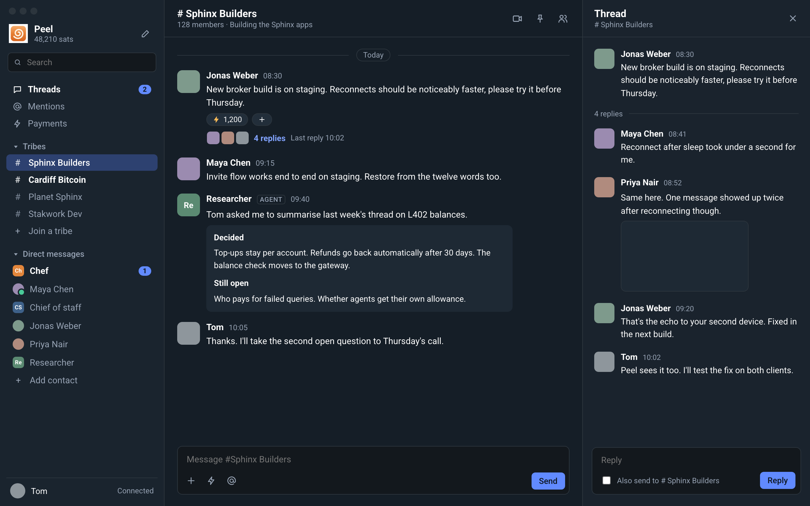
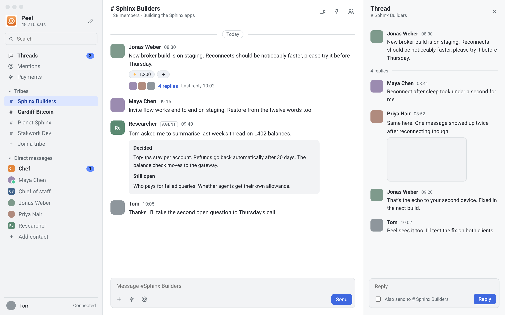

# Peel design

Last updated 2026-10-07. The target layout and visual language for the Mac app.
Nothing here is built yet beyond the current shell; phase files say when each
part lands. The source mock lives on the canvas "Peel layout directions"
(direction D); the screenshots below are taken from it.

## Decision

The layout follows Slack: tribes and direct messages in a sidebar, the
conversation in the middle, threads opening on the right. It replaces the
official app's tabbed chat list. Three other directions (a three-column mail
layout, a conversation with an inspector panel, an agent inbox home) were
mocked and rejected on 2026-10-07.

Colours and type are Sphinx's, because Peel is meant to replace the official
apps. The Peel logo stays in the sidebar header for now so Tom can tell the
two apps apart.

## Layout

Three regions, left to right. On a narrow window the thread panel closes first,
then the sidebar collapses; panels never overlay the conversation.

### Sidebar (260 pt)

Top to bottom:

1. **Header.** Peel logo, "Peel", and the wallet balance in sats under it.
   On the right, Sphinx's connection bolt: green when connected, orange
   otherwise; clicking it shows the state, the retry countdown and the last
   connection error. A compose button will start a new direct message.
2. **Search.** One field over every conversation.
3. **Threads.** Threads you started or replied to that have new replies, with
   an unread count.
4. **Mentions.** Messages that mention you, across tribes.
5. **Payments.** Payment history: received, sent, boosts, invoices. The
   receive screen from the v1 scope lives here.
6. **Tribes.** One row per tribe, prefixed `#`, like Slack channels. Unread
   tribes are bold. Ends with "Join a tribe". The section collapses.
7. **Direct messages.** One row per contact, unread ones bold with a count.
   Ends with "Add contact". The section collapses.
8. **Footer.** Your avatar and your name. (The connection state moved to the
   header bolt, 2026-10-07.)

No tabs and no filter chips. Sorting inside each section: most recent first.

### Conversation (flexible)

- **Header.** The tribe name with `#` (or the contact's name), member count and
  description for a tribe, and three icon buttons: call, pinned messages,
  members.
- **Messages are bubbles: theirs on the left, yours on the right** (Tom,
  2026-10-07; the flat Slack style in the mock was tried in the app and
  dropped). Yours use Sphinx's sent-message blue, theirs the received grey.
  Time under each bubble. How tribe messages with many senders show the
  sender is decided with phase 3.
- **Day dividers** ("Today", "Yesterday", then dates).
- **Boosts** show as a chip under the message: a bolt and the total sats. A
  "+" chip next to it boosts.
- **Thread summary** under a message that has replies: the repliers' avatars,
  "N replies" as a link, and "Last reply HH:MM". Clicking it opens the thread
  panel.
- **Composer.** A rounded text field ("Message #Tribe" or "Message Name")
  and a round send arrow beside it, not a "Send" button (Tom, 2026-10-07).
  Attach, send sats and mention join it with their phases; no control appears
  before it works.

### Thread panel (360 pt)

Opens when you click a thread summary or "Reply in thread", and closes with
its close button.

- Header "Thread" with the tribe or contact name under it.
- The original message, a "N replies" divider, then the replies.
- A reply composer with an "Also send to #Tribe" checkbox, as in Slack.

## Agents

An agent is a contact. It sits in Direct messages next to people, with no
separate section. Two differences:

- **Avatar shape.** Agents have rounded-square avatars with initials; people
  have round avatars.
- **An "AGENT" label** next to the name on its messages, so others in a tribe
  know they are talking to an agent. Kept on 2026-10-07.

Agent-specific views (budget, schedule, activity, approval cards) are not part
of this layout yet; see `../agent-native.md`.

## Profile and onboarding

Approved by Tom on 2026-10-07; mocks on the "Peel layout directions" canvas
(Profile, onboarding 1–5, restore 2b–3b).

- **Profile** is a full page in the detail column, opened from the sidebar
  footer. It holds your photo, name and short key; a "Your contact info" card
  with a QR code, Copy and Create invite; Account (name, balance, server,
  devices); Security (PIN, Touch ID, Show words behind PIN or Touch ID);
  Notifications; and "Remove this account from this Mac", the only red text.
- **New account:** Welcome (invite or restore), then four steps: invite,
  name and photo, a six-digit PIN with an optional Touch ID unlock, and the
  twelve words with an "I've written them down" check before Peel opens.
- **Restore:** twelve word fields (paste fills all twelve, suggestions as you
  type), then a progress page: account, contacts, messages with a count,
  tribes. "Open Peel" works before history finishes.
- **The PIN is required, as in the official apps** (Tom, 2026-10-07). The
  restore flow gets a PIN step too. How the PIN protects the words is a
  phase 2 decision; see `docs/phases/02-messaging.md`.

**Built 2026-10-07** (`OnboardingView.swift`, `LockView.swift`): both flows,
the PIN at launch for the app's own profile, the optional re-lock
(`defaults write dev.peel.mac pinTimeoutHours <hours>` until Profile has it),
"Paste twelve words", and restore progress from `Engine.Event.history`. Tom
ran the restore with the throwaway's words: contacts and conversation came
back, the words sit in the Keychain and no words file exists.

Not built: the photo picker (needs uploads to the media server), word
suggestions while typing, the Profile page.

Review notes left open:

- No limit on PIN attempts at the lock screen; the official app has none.
  Through the screen a full search takes about 4.6 days at 0.4 s per try.
- Re-locking after the timeout hides the window but keeps data in memory; the
  official app clears its context.
- If `Account.restore` fails after the words are saved, a retry reports that an
  account already exists until the app is relaunched.

## Colour

Tokens come from the official Mac app's colour catalog
(`sphinx-mac-v2/com.stakwork.sphinx.desktop/Colors.xcassets/SphinxNew`). The app
is dark only for now (Tom, 2026-10-07); the light values are kept in
`Theme.swift` for later.

| Role | Dark | Light | Sphinx token |
|---|---|---|---|
| Sidebar background | `#1A242E` | `#F2F3F5` | LightBG |
| Conversation background | `#151E27` | `#FFFFFF` | Body |
| Thread panel background | `#1A232D` | `#F7F8F9` | HeaderBG / ThreadOriginalMsg |
| Input background | `#13181D` | `#F2F3F5` | InputBG1 |
| Primary text | `#FFFFFF` | `#292C33` | PrimaryText |
| Secondary text | `#97A3B4` | `#646C73` | SecondaryText, adjusted |
| Dividers | `#2C353D` | `#DCE0E3` | NewMessageIndicator / LightDivider |
| Quoted or summary block | `#1E2934` | `#F2F3F5` | ThreadOriginalMsg / ReceivedMsgBG |
| Accent (unread counts, links, selection) | `#618AFF` | `#618AFF` | PrimaryBlue |
| Filled buttons | `#618AFF` | `#3F68E0` | PrimaryBlue, adjusted |
| Your message bubble | `#3E6189` | `#DDEDFD` | SentMsgBG |
| Their message bubble | `#222E3A` | `#F2F3F5` | ReceivedMsgBG |
| Boost bolt | `#FFBC58` | `#FFBC58` | SphinxOrange |
| Online dot | `#49C998` | `#49C998` | PrimaryGreen |

Two deliberate departures from the Sphinx values, both for contrast (text
needs 4.5:1):

- Secondary text in dark mode is `#97A3B4`; Sphinx's `#6B7A8D` is too faint on
  navy.
- Filled buttons in light mode are `#3F68E0`; white text on `#618AFF` is too
  faint.

Colour is state, never decoration (Tom's `tom-ui` rules): blue marks unread,
selected and actionable; red only for destructive or blocking moments.

## Type

Roboto, as the official apps use, at 400, 500 and 700. Sizes: 16 pt for
conversation and panel titles, 14 pt for messages and sidebar rows, 12 pt for
times and secondary lines. Times and sats use tabular figures.

## Motion

Restrained. The thread panel slides in from the right in about 200 ms with an
ease-out curve and leaves faster. Sidebar selection, hovers and keyboard
actions do not animate.

## What the engine needs

Each part of the layout depends on something below the UI. Most of it exists
in the core or in the official apps' message conventions.

| UI part | Needs | Where it comes from |
|---|---|---|
| Tribes section | Join, list and read tribes | Core: `join_tribe`, `list_tribe_members`; phase 3 |
| Thread summary and panel | Group replies by thread | Message JSON `threadUuid` / `replyUuid`, as the official apps send them; phase 3 |
| Threads item | Threads you took part in with new replies | Peel's own query over stored messages |
| Mentions item | Messages that mention you | Peel parses `@alias` in stored messages; check how the official apps mark mentions |
| Payments item | Payment history | Core: `fetch_payments`; phase 4 |
| Boost chips | Boost totals per message | Boost messages reference the boosted message; phase 4 |
| Balance in header | Live balance | Core returns it with each call; available now |
| AGENT label | Know a contact is an agent | Not defined yet: needs a profile field or message convention, see `../agent-native.md` |

## Build order

The layout can be built before the features behind it, with empty states:

1. Sidebar structure with Direct messages working (what phase 1 already
   supports), Tribes, Threads, Mentions and Payments present but empty.
2. Flat message style and the composer.
3. Tribes, the thread panel and thread summaries with phase 3.
4. Payments, boosts and send-sats with phase 4.
5. Mentions once message storage can answer it.

## Status

**Steps 1 and 2: built (2026-10-07).**

- Dark Sphinx colours (`Sources/PeelApp/Theme.swift`) and Roboto bundled
  (`Assets/Fonts`, registered through `ATSApplicationFontsPath` in
  `scripts/run-app.sh`; the system font when run unbundled).
- Hidden title bar; the sidebar header carries the app icon, "Peel" and the
  balance.
- Sidebar: search (filters the lists, held in `AppModel.searchQuery`), Threads,
  Mentions, Payments with empty states, Tribes with "No tribes yet", Direct
  messages, "Add contact" (a popover next to the row, through
  `Engine.addContact`), and a footer with your name that opens your contact
  info to copy.
- Delivery and reads (2026-10-07): the connection bolt in the header; a green
  bolt beside the time of a message the server confirmed; "Not delivered ·
  Retry · Discard" under a failed one; chat errors in a quiet bar above the
  composer; unread direct messages bold with a blue count, muted ones dimmed
  with a crossed-out bell (Mute / Unmute in the row's context menu). Times
  show under the last message of a run and beside any bubble on hover.
- Conversation: header with the name and short key, day dividers, bubbles,
  the composer with the round send arrow. A banner at the bottom on
  development profiles says the twelve words are in a plain file.

Verified on the throwaway profile: messages both ways render, the layout holds
at the default window size. Not yet checked by hand: adding a contact through
the popover.

Not built, noticed in use:

- **No notification for incoming messages.** Push is off limits (one push
  token per account, owned by the official app). A local notification when a
  message arrives and the window is not in front needs no server change; it
  needs the signed app from phase 2 task 1.
- Sidebar rows are buttons, not a `List`, so arrow keys do not move between
  conversations yet.
- The sidebar width is fixed at 260 pt and does not collapse; the window's
  minimum width (760 pt) keeps the conversation readable.

The rejected native-sidebar variant and the first Slack-skin build are kept in
the session scratchpad only; the mock canvas has all four mocked directions.
