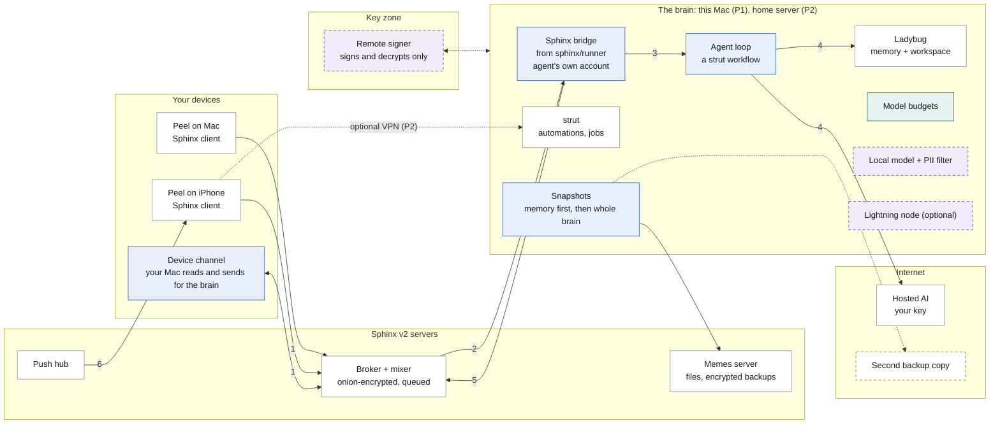

# Peel's end state

Last updated 2026-10-16. **The picture everything else builds toward**, from
the decisions in [foundation.md](foundation.md). It shows the parts, the path
a message takes, and which phase brings each part. A drawn version is the
"Peel end-state map" artifact (https://claude.ai/artifact/SU2wNEXhw94WB6C5788bCX);
this page is the record.

## In one paragraph

Your assistant lives on a brain you own and is a Sphinx contact. You message
it from your Mac or iPhone as you would a person, so it gets Sphinx's
encryption, offline queues and push for free. On the brain, a small bridge
holds the agent's own Sphinx account and hands each message to strut, which
runs the agent, its memory (Ladybug) and its routines. strut never holds your
keys: anything that needs your account (reading your chats, sending as you,
Calendar) is done by your Mac when strut asks. The brain is your Mac by
default and can move to a home server.

## The map

Grey is built today, blue is Phase 1, green Phase 2, violet Phase 3, and
dashed amber is open.

## A message to the agent

1. You write to the agent from your Mac or iPhone, as to any contact.
2. The broker queues it, onion-encrypted, until the brain is online. The
   bridge opens it with the agent's own account.
3. The bridge starts a run of the agent loop in strut.
4. The loop recalls memory from Ladybug and asks a model.
5. The reply goes back through the bridge and the broker, encrypted.
6. The push hub wakes your phone.

If the brain is asleep or moving, the message waits in the queue. Nothing new
is needed for auth, push or encryption.

When a run needs your account, strut sends a request to your Mac as a hidden
control message in the agent's DM. The Mac does it with your keys and sends
back the result. With no device awake, the run shows "waiting for your Mac".

## Phases

| Phase | What it brings | Where the brain is |
|---|---|---|
| Built today | Peel on Mac and iPhone on Sphinx v2; strut bundled in Peel on Ladybug (memory, automations, jobs); the agent loop in Swift on one Mac; `sphinx/runner`, a headless account that receives but doesn't reply | The Mac, inside Peel |
| 1. The agent is a contact | The bridge from `sphinx/runner`, bundled in Peel.app; the agent's own Sphinx account; the loop moves into strut; one conversation, the agent DM, on Mac and iPhone; the device channel, answered by the Mac; memory backed up in the whole-brain format | Your Mac |
| 2. Always on, moves whole | A home server as one Docker bundle; whole-brain snapshot and handover, Mac to home server and back; the iPhone answers device requests too (the first device to accept does it); model budgets; real auth on strut; an optional Tailscale VPN for the graph view and live job steps | Your Mac, or a home server |
| 3. Keys off the brain | A remote signer, so your account can run on the brain while your key stays in an isolated key zone; an optional Lightning node on the same signer; a local model and a PII filter before hosted AI; maybe a threshold group (needs threshold ECDSA) | Either, with a signer |

What gates the start of each phase:

- **Phase 1** starts with the build plan in [agent-on-strut.md](agent-on-strut.md)
  (stakwork/peel#303, for review). Turning the agent on for real accounts waits
  on Evan's two answers below.
- **Phase 2** starts when Phase 1 is in daily use. It builds on
  [brain-handover.md](brain-handover.md) and [peel-brain.md](peel-brain.md).
- **Phase 3** is a direction, not yet planned. VISION open question 8.

## Where the work stands (2026-10-16)

| Piece | State | Where |
|---|---|---|
| Five foundation decisions | Answered | [foundation.md](foundation.md), #301, #302 |
| Ladybug snapshot round trip | Proven: memory and workspace graphs round-trip losslessly; a whole-brain snapshot needs format 2 | stakwork/strut#193 |
| `sphinx/runner` as the bridge | Spike works on the local stack: key exchange, replies, catch-up, about 360 lines | [research/runner-bridge-spike.md](research/runner-bridge-spike.md), #304 |
| Phase 1 design and PR plan | Written, 13 PRs, for Tom's review | [agent-on-strut.md](agent-on-strut.md), #303 |

## Open

- **For Evan:** whether the bridge is a strut mode of `sphinx/runner`, and the
  key derivation scheme (it starts from the seed either way).
- **For Evan:** where the second backup copy goes. Not a Phase 1 blocker.
- **For Tom:** how the agent account is funded. Accepting the owner's key
  exchange costs the agent 3,000 msat plus a ping, so either the owner funds
  it on pairing or the bridge adds the owner, who then pays.
- **Sphinx team:** whether the push hub accepts Peel's iPhone app (spike S4).
